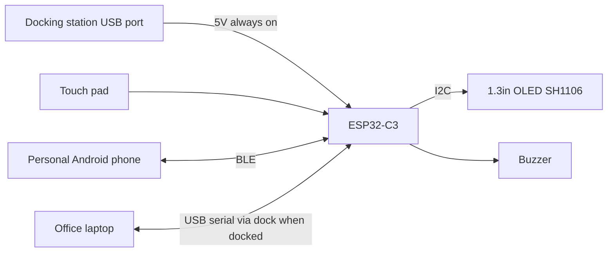
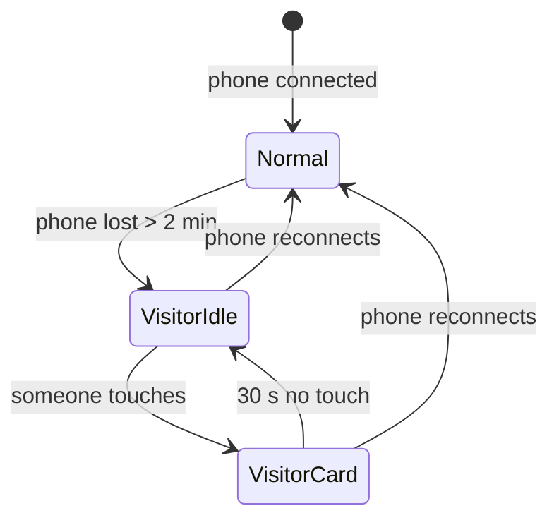
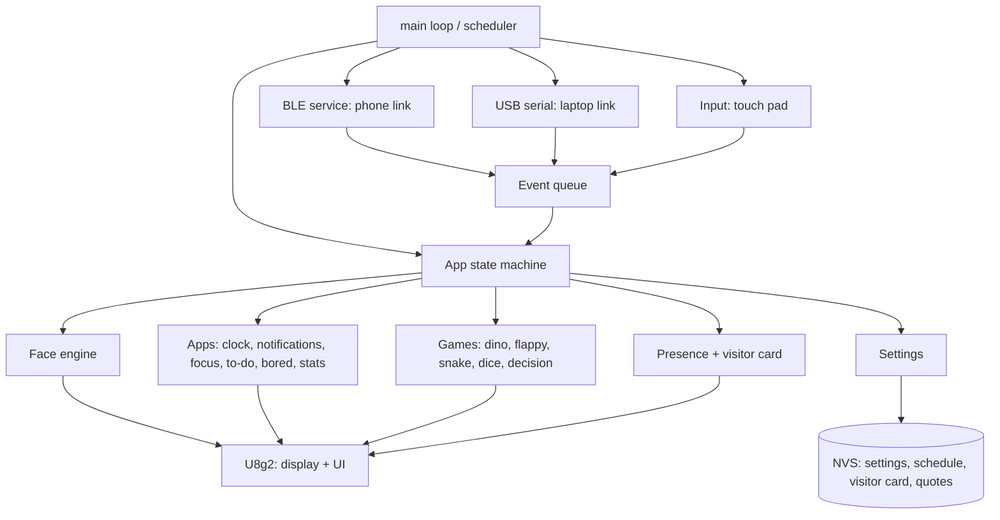
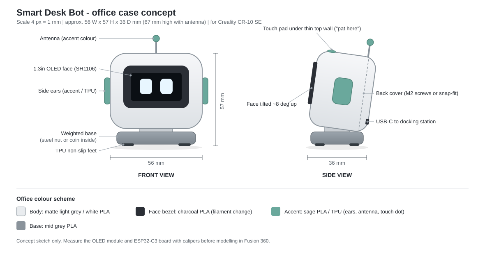

# Smart Desk Bot

A small, cute, USB-powered desk companion robot for the office. It has a 1.3" OLED "face", connects to a personal Android phone over **Bluetooth Low Energy only** (no Wi-Fi) and to the office laptop over **USB**, and works like a mix of a smartwatch, a personal assistant and a tiny pet. It also has a menu with a few mini games.

> Status: concept / planning. This is a hobby project built with AI-assisted ("vibe") coding, plus a 3D-printed enclosure.

---

## 1. Goals

| # | Goal | Notes |
|---|------|-------|
| 1 | Expressive robot face | Animated eyes and emotions on a 128x64 OLED |
| 2 | Phone companion over BLE | Time, notifications, calls, calendar, battery, weather (all relayed by the phone) |
| 3 | No Wi-Fi at all | Office policy. Wi-Fi radio is turned off in firmware |
| 4 | Presence + visitor mode | Phone connected = at desk. Not connected = visitor card (Away / WFH / Leave) based on the WFH plan from the app |
| 5 | Personal assistant | Reminders, focus timer, breaks, water, to-dos |
| 6 | Light entertainment | Games (Dino, Flappy, Snake, Dice, Decision maker) + "I'm bored" quotes and ideas |
| 7 | Cute 3D-printed case | Designed in Fusion 360, printed on a Creality CR-10 SE |
| 8 | Low power, always on | USB powered, dims/sleeps, protects the OLED from burn-in |
| 9 | Own Android app | Vibe-coded in Android Studio with Gemini: to-do, WFH planner, visitor card, quotes, faces, settings |
| 10 | Office laptop link (USB) | Outlook mail + meetings, Teams (to be tested), laptop lock, time - work data stays off the personal phone |

---

## 2. Hardware

### 2.1 Bill of materials

| Part | Suggested model | Purpose | Required |
|------|-----------------|---------|----------|
| MCU | ESP32-C3 SuperMini or Seeed XIAO ESP32-C3 | Brain, BLE 5.0, native USB-C | Yes |
| Display | 1.3" OLED 128x64, **SH1106** driver, I2C (4-pin) | Face and UI | Yes |
| Touch sensor | 1x TTP223 capacitive touch pad | The only input: pat the head, menu, games | Yes |
| Buzzer | Passive piezo buzzer (+ 100 Ω resistor) | Beeps, melodies, game sounds | Recommended |
| Cable | USB-C data cable | Power + flashing | Yes |
| Misc | Dupont wires / thin silicone wire, M2 screws, heat-set inserts | Assembly | Yes |

**Important notes**

- **ESP32-C3 supports only Bluetooth Low Energy (BLE 5.0), not Bluetooth Classic.** This is fine: modern smartwatches also use BLE. It just means the phone side must speak BLE (GATT).
- 1.3" OLED modules are usually **SH1106**, while 0.96" ones are SSD1306. Check your module; the wrong driver gives a shifted / noisy picture.
- Verify the I2C address (usually `0x3C`) with an I2C scanner sketch.
- TTP223 default mode: output goes HIGH while touched (momentary). Keep its A/B jumpers open.

### 2.2 Suggested pin map (ESP32-C3 SuperMini)

> Verify against your exact board's pinout before wiring. Avoid strapping pins GPIO 2, 8, 9 for inputs, and GPIO 18/19 (USB D-/D+).

| Function | GPIO |
|----------|------|
| OLED SDA | 5 |
| OLED SCL | 6 |
| Touch (TTP223 OUT) | 1 |
| Buzzer | 7 |
| On-board LED | 8 (board default) |

The TTP223 output is push-pull and active HIGH, so the pin is a plain `INPUT` (no pull-up).

### 2.3 Block diagram



---

## 3. Development tools

### 3.1 IDE: Arduino IDE 2.x

All firmware is written, built and flashed with **Arduino IDE 2.x** only.

Board setup:
1. **File > Preferences > Additional boards manager URLs** - add the Espressif ESP32 URL from the official arduino-esp32 docs.
2. **Boards Manager** - install **esp32 by Espressif Systems**.
3. **Tools** settings:

| Setting | Value |
|---------|-------|
| Board | `ESP32C3 Dev Module` (or `XIAO_ESP32C3` for the Seeed board) |
| USB CDC On Boot | `Enabled` (so `Serial` works over USB-C) |
| CPU Frequency | `80MHz` (enough, lower power) |
| Partition Scheme | `Huge APP (3MB No OTA/1MB SPIFFS)` (BLE + fonts + games need space) |
| Upload Speed | `921600` |

If upload fails: hold **BOOT**, tap **RESET**, release **BOOT**, then upload again.

Arduino IDE rules to remember:
- The sketch folder name must match the `.ino` file name.
- Extra `.h` / `.cpp` files in the sketch folder show up as tabs.
- Sub-folders are only compiled if they are inside a `src/` folder in the sketch.

### 3.2 Firmware libraries (Library Manager)

| Library | Use |
|---------|-----|
| **`U8g2`** (by olikraus) | **Display driver + UI library**: SH1106 driver, drawing, fonts, icons, menus (MUI) |
| `NimBLE-Arduino` | Lightweight BLE stack (less RAM/flash than default BLE) |
| `ChronosESP32` | Ready-made smartwatch protocol for the **Chronos** Android app (fast path) |
| `OneButton` | Tap, double tap, long press on the touch pad (active HIGH, no pull-up) |
| `Preferences` (built-in) | Save settings, high scores in flash (NVS) |

### 3.3 UI with U8g2

U8g2 is used for **everything on screen**: robot face, clock, notifications, menus and games.

```cpp
#include <U8g2lib.h>
#include <Wire.h>

// SH1106 128x64, full frame buffer (1 KB RAM), hardware I2C: clock=6, data=5
U8G2_SH1106_128X64_NONAME_F_HW_I2C u8g2(U8G2_R0, U8X8_PIN_NONE, 6, 5);

void setup() {
  u8g2.begin();
}

void loop() {
  u8g2.clearBuffer();
  u8g2.drawRBox(30, 18, 24, 28, 6);  // left eye
  u8g2.drawRBox(74, 18, 24, 28, 6);  // right eye
  u8g2.sendBuffer();
}
```

| U8g2 feature | Used for |
|--------------|----------|
| Full buffer mode (`_F_`) + `clearBuffer()` / `sendBuffer()` | Smooth, flicker-free animation |
| `drawRBox()`, `drawDisc()`, `drawTriangle()` | Eyes, blinks, emotions (squash, heart, sleepy lids) |
| `drawXBMP()` | Icons and bitmaps (XBM format, e.g. exported from GIMP) |
| Fonts: `u8g2_font_6x10_tf`, `u8g2_font_helvB08_tr`, `u8g2_font_logisoso32_tn` | Small text, titles, big clock digits |
| Icon fonts: `u8g2_font_open_iconic_*` | App icons (message, phone, battery, bell, game) |
| `setContrast(0-255)` | Brightness setting, dimming, night mode |
| `setPowerSave(1/0)` | Screen off / on (burn-in protection, away mode) |
| `getStrWidth()` | Centering and scrolling text |
| **MUI** (`MUIU8G2.h`, part of U8g2) | Optional ready-made menu system: maps to touch as tap = next field, long press = select, double tap = leave form |

### 3.4 Other tools

| Tool | Use |
|------|-----|
| Fusion 360 | Enclosure design |
| Creality Print / OrcaSlicer / Cura | Slicing for the Creality CR-10 SE |
| GIMP | Draw icons / face frames and export as `.xbm` for U8g2 |
| nRF Connect (Android) | Debug BLE services and characteristics |
| Android Studio + Gemini | Vibe-coded Kotlin companion app (phone side only) |
| Git + GitHub | Version control |

---

## 4. Connectivity: personal phone (BLE) and office laptop (USB)

The robot has no internet. Two gateways feed it data:

| Source | Link | Sends to the robot |
|--------|------|--------------------|
| **Personal Android phone** (OnePlus 12) | BLE | WhatsApp, calls, SMS, personal email, to-do, WFH plan, visitor card, quotes, face control, time |
| **Office laptop** | USB serial (COM port) | Outlook mail, Outlook meetings, Teams (to be tested), laptop locked / unlocked, time |

Office email, Outlook and Teams are **not available on the personal phone** (company policy), so the **laptop is the only source of work data** (see 4.7).

The phone reads time, notifications, calendar, weather, etc., and sends small packets over BLE.

### 4.1 Options

| Option | Effort | What you get |
|--------|--------|--------------|
| **A. Chronos app + `ChronosESP32` library** | Low | Time sync, notifications, incoming call, weather, find phone, music control, phone battery |
| B. Gadgetbridge | Medium | Open source, privacy friendly, but needs a supported/emulated device protocol |
| C. Tasker / MacroDroid + BLE plugin | Medium | Custom automations, limited UI |
| **D. Custom companion app ("Desk Buddy")** | High (vibe-coded) | Full control: to-do, WFH planner, visitor card, quotes, calendar, settings |

**Plan:** Use **Option A** only for a quick early test of the BLE link. **Option D is the main app**, because WFH planning, visitor card, to-do and quotes are not possible with Chronos.

### 4.2 Custom BLE protocol (for the custom app)

One custom GATT service with a few characteristics:

| Characteristic | Direction | Content |
|----------------|-----------|---------|
| `time` | Phone -> Bot | Epoch time + timezone offset |
| `notify` | Phone -> Bot | App id, title, short text (truncated) |
| `call` | Phone -> Bot | Caller name, state (ringing / ended) |
| `status` | Phone -> Bot | Phone battery, DND state, steps, next meeting |
| `todo` | Phone <-> Bot | To-do list (top items); "done" ticks go back to the phone |
| `schedule` | Phone -> Bot | Day plan for the next 8 weeks: Office / WFH / Leave / Holiday + office hours |
| `visitor` | Phone -> Bot | Visitor card: name, messages, email, contact number, show/hide flags |
| `quotes` | Phone -> Bot | Custom quotes, slogans, activities, decision-maker option lists |
| `settings` | Phone -> Bot | Brightness, sound, reminders, night hours, privacy mode |
| `face` | Phone -> Bot | Emotion id (happy, sad, love...), how long to show it, or "back to automatic" |
| `event` | Bot -> Phone | Touch events: find phone, mute call, focus started, to-do done |
| `log` | Bot -> Phone | Visitor log (touch times while you were away) |

Messages are small (compact binary or short JSON, < 200 bytes each). Larger data (quotes, schedule) is sent in chunks.

Keep this table as the **single source of truth** for both sides: paste it into Gemini (app) and Copilot (firmware) prompts so both implement the same protocol.

### 4.3 Security and privacy

- Use **BLE bonding with passkey pairing and encryption**, so only your phone can connect and push data.
- Accept writes only from the bonded device; ignore everything else.
- **Privacy mode** (default ON at the office): show only app icon + sender, not message text.
- Do not store notification content in flash; keep it in RAM only and clear on disconnect.
- Wi-Fi is disabled in code (`WiFi.mode(WIFI_OFF)`); no Wi-Fi credentials are ever stored.
- Check your company's policy on personal BLE devices before using it at work.
- The visitor card is visible to anyone who touches the robot: prefer your **work email and desk phone**, and turn off any field you do not want to show.

### 4.4 Android companion app: "Desk Buddy"

Fully vibe-coded in **Android Studio with Gemini** (built-in AI assistant).

| Item | Choice |
|------|--------|
| Language | Kotlin |
| UI | Jetpack Compose (Material 3) |
| Storage | Room database (to-dos, schedule, quotes, visitor log) + DataStore (settings) |
| BLE | Android BLE GATT API (or Nordic Android-BLE-Library to keep code simple) |
| Background link | Foreground service (connected-device type) + auto-reconnect |
| Min Android | 8.0 (API 26) |

#### App screens

| Screen | Features | Synced via |
|--------|----------|-----------|
| Home | Connection status, robot mood, last sync, "Ping robot" (robot beeps and waves) | `status`, `event` |
| To-do | Add / edit / delete tasks, priority, due date, reorder. Top 3 shown on the robot; long press on the robot marks a task done and syncs back | `todo` |
| WFH planner | Week calendar view, mark each day **Office / WFH / Leave / Holiday**, weekly pattern (e.g. every Mon + Fri WFH), override single dates, office hours | `schedule` |
| Visitor card | Your name, message per state (Away / WFH / Leave / After hours), email, contact number, show/hide toggles, live preview of the 128x64 screen | `visitor` |
| Quotes & ideas | Built-in list + your own quotes, slogans and "bored" activities; option lists for the decision maker (e.g. lunch places) | `quotes` |
| Notifications | Pick which apps are forwarded, privacy mode | `notify` |
| Faces | Pick a face / emotion for the robot, set how long, preview, "back to automatic" | `face` |
| Reminders | Water, break, focus durations, night hours | `settings` |
| Visitor log | Who-touched-when list while you were away | `log` |
| Robot settings | Brightness, sound, robot name, pair / forget | `settings` |

#### More app ideas (later)

- Morning summary on arrival: "3 to-dos, first meeting 10:00, WFH tomorrow".
- Habit streaks: water count, breaks taken, focus sessions per day, shown as a weekly chart.
- Next meeting from the phone calendar (`CalendarContract`).
- Home-screen widget to switch today between Office / WFH quickly.
- Backup / restore of to-dos, schedule and quotes as a JSON file.

#### Android permissions

`BLUETOOTH_SCAN`, `BLUETOOTH_CONNECT` (Android 12+), `POST_NOTIFICATIONS`, `FOREGROUND_SERVICE` + `FOREGROUND_SERVICE_CONNECTED_DEVICE` (Android 14+), Notification access (for forwarding), `READ_PHONE_STATE` + `READ_CALL_LOG` (incoming call number), `READ_CONTACTS` (number -> name), `READ_CALENDAR` (optional), `ANSWER_PHONE_CALLS` (optional, reject call from the robot).

### 4.5 Notifications and calls (personal phone)

Forwarded by default: **WhatsApp (messages + calls), phone calls, SMS** and other app notifications selected in the app.

| Source | Robot shows | Contact not saved |
|--------|-------------|-------------------|
| Phone call | Call icon + contact name | Number, e.g. `+91 98xxx xxxxx` |
| Hidden / private call | "Private number" | - |
| WhatsApp message | WhatsApp icon + name (+ text if privacy mode is off) | Number or `~ProfileName` |
| WhatsApp group | WhatsApp icon + group + sender | Sender number |
| WhatsApp voice / video call | "Call from \<name\>" | Number |
| Personal email (Gmail etc.) | Mail icon + sender name + subject | Whatever the notification shows |
| SMS / others | App icon + sender + short text | Number / sender id |

How the app gets it:
- Messages and email: `NotificationListenerService` (title = sender, text = message).
- Phone calls: phone-state listener gives the number, then a contacts lookup (`ContactsContract.PhoneLookup`) gives the name.
- Display rule: **contact name -> number -> "Unknown" / "Private number"**.

Limits:
- Long names scroll; message text is cut to about 2 lines on 128x64.
- U8g2 fonts show Latin letters and digits. Names saved in non-Latin scripts (Tamil, Hindi, ...) are sent as the number instead. Emojis are removed.
- Privacy mode (default ON at the office) shows only icon + name / number, no message text.

### 4.6 Phone compatibility (OnePlus 12)

| Item | Detail |
|------|--------|
| Phone Bluetooth | 5.4, full BLE support (backward compatible with the ESP32-C3's BLE 5.0) |
| Android | 14 / 15, covered by the permissions above |
| Range | About 5-10 m in an office: good for "at desk" vs. "away" detection |

OxygenOS closes background apps aggressively. To keep the link alive:
1. Settings -> Battery -> Desk Buddy app -> **Don't optimize / Allow background activity**.
2. Keep the app's **foreground service** (small permanent notification).
3. Optional: pair via Android **Companion Device Manager** so the robot is treated like a smartwatch.

First test before any app code: flash a NimBLE server example, connect with **nRF Connect** on the phone, and write a value to a characteristic.

### 4.7 Office laptop link (USB)

The ESP32-C3's native USB shows up on the laptop as a **COM port**. A small Python script on the laptop reads Outlook (and later Teams) and sends one short JSON line per event at 115200 baud. No Wi-Fi, no cloud.

The robot is plugged into the **docking station**: the laptop sees the COM port whenever it is docked. The `time` message doubles as a heartbeat; no message for 2 minutes = laptop link down (undocked, asleep or script stopped).

#### Feasibility

| Source | Method | Status |
|--------|--------|--------|
| Outlook (classic) new mail | Outlook COM `NewMailEx` event via `pywin32` | **Verified** - [laptop_link/outlook_check.py](laptop_link/outlook_check.py) reads sender + subject |
| Outlook calendar (incl. recurring meetings) | Outlook COM, calendar `Restrict` + `IncludeRecurrences` | **Verified** - today's meetings listed correctly |
| Laptop locked / unlocked | Windows session lock events | Planned |
| Time sync | Laptop clock | Planned |
| Teams chats, calls, meeting calls, mentions | Windows notification listener (Teams notification style must be **Windows**) | **To be tested**. Fallback: read the local Windows notification database read-only (undocumented, may break with updates) |
| New Outlook | No COM interface | Not possible directly; use Windows notifications |
| Teams messages / presence via Microsoft Graph | Needs app registration + admin consent | Not planned |

Environment: Python 3.10 + `pywin32` (available on the laptop), classic Outlook.

#### Mail rules (laptop side)

1. Only **new unread** mail that arrives while the script runs (no history).
2. **Block list** for automated senders (newsletters, daily digests, tool notifications, HR / training reminders).
3. **VIP list** (manager, team) -> special face + beep.
4. Short sender name: drop department suffixes in brackets, `LAST First` -> `First L.`.
5. Subject cut to about 20 characters; `Re:` / `Fwd:` shown as "\<name\> replied".
6. Optional: subjects with "urgent" / "action required" -> alert face.

#### Meeting rules

| Case | Robot behavior |
|------|----------------|
| Location is a Teams meeting | Teams icon instead of location text |
| Physical location | Pin icon + short location |
| Overlapping events | Shorter / Teams meeting shown as "now", the other as "also" |
| Next meeting | Countdown: "Weekly sync in 5 min" + alert face and beep at reminder time |
| Declined (`ResponseStatus`) or Free (`BusyStatus`) | Skipped |
| Out of office (`BusyStatus`) | Feeds the visitor card |
| Currently in a meeting | Visitor card: **"In a meeting until 16:00"** |

```
Next:  15:30  Weekly sync    [Teams]   in 12 min
Now:   In meeting until 16:00          (visitor card)
Free:  No more meetings today :)
```

#### Teams calls and meeting calls

| Case | Robot shows | Sound (see 5.7) |
|------|-------------|-----------------|
| Someone calls you on Teams | Teams icon + **"Calling..."** + caller name, ringing animation, surprised face | Teams chime, repeats |
| Someone calls you into a meeting ("X is calling you to join") | Teams icon + **"Meeting call"** + caller + short meeting title | Teams chime, repeats |
| Meeting starts (Outlook calendar) | **"Starting now: Weekly sync"** | Two soft beeps |
| Call answered / declined | Ringing stops | - |
| Call missed | "Missed Teams call: \<name\>" stays in the notification list | - |

- Teams call pop-ups are Windows notifications, read with the same notification listener as Teams chats. Teams settings: notification style = **Windows**, calls not muted.
- Ringing stops when the call notification disappears (answered / declined) or after 45 s.
- A tap on the robot only **mutes the tone**; the call is answered on the laptop.
- If Teams notifications cannot be read: meeting start from Outlook (verified) still rings "Starting now"; 1:1 Teams calls then need the notification-database fallback.

#### USB message format (laptop -> robot, one JSON line each)

| Type | Example |
|------|---------|
| Time | `{"t":"time","epoch":1793000000,"tz":330}` |
| Mail | `{"t":"mail","from":"Ravi K.","sub":"Weekly report","vip":1}` |
| Meeting | `{"t":"meet","now":"Daily sync","until":"15:30","next":"Weekly sync","at":"15:30","teams":1}` |
| Lock | `{"t":"lock","v":1}` |
| Teams message | `{"t":"teams","kind":"chat","from":"Priya S."}` (`chat` / `mention`) |
| Teams call | `{"t":"teams","kind":"call","from":"Priya S.","state":"ring"}` / `{"t":"teams","kind":"call","state":"end"}` |
| Teams meeting call | `{"t":"teams","kind":"meetcall","from":"Priya S.","meet":"Weekly sync","state":"ring"}` |

On the robot: `Serial.readStringUntil('\n')` + ArduinoJson, then the same event queue as BLE.

#### Work data rules

- Work data flows **laptop -> robot only**. It is never forwarded over BLE to the personal phone.
- The robot shows only **icon + short sender + short subject / meeting title**. No mail body is ever read.
- Nothing work-related is stored in flash; RAM only, cleared when the laptop disconnects.
- Get **IT approval** for a personal USB device and a local script that reads Outlook / Teams.
- Do not paste real work mail / meeting content into external tools when testing; "it works" or the error message is enough.
- Powered from the docking station, the robot keeps running when the laptop sleeps or is undocked; only the data link drops.

#### Laptop files

| File | Status |
|------|--------|
| [laptop_link/outlook_check.py](laptop_link/outlook_check.py) | Done: read-only check, prints last 10 mails + today's meetings |
| `laptop_link/desk_link.py` | Planned: live link (time, new mail, meetings, lock state) -> COM port |

---

## 5. Features

### 5.1 Robot face and emotions

Animated eyes (Cozmo / EMO style) drawn with rounded rectangles, so they can blink, squash and move smoothly.

| Emotion | Trigger |
|---------|---------|
| Idle | Default, random blinks and looking around |
| Happy | Phone connects, game won, step goal reached |
| Excited / surprised | New notification, incoming call |
| Love (heart eyes) | Head touched / patted |
| Sleepy | Late evening, long inactivity |
| Sleeping (Zzz) | Night mode, screen nearly off |
| Sad | Phone disconnected (you left) |
| Focused | Focus timer running |
| Annoyed | Sitting too long without a break |
| Welcome back | Phone reconnects after being away |
| Alert / serious | VIP mail, meeting about to start |

Faces can also be set manually from the app (`face`), then return to automatic.

Extra: a simple **mood system** (happiness/energy values) that changes with your interactions, like a small Tamagotchi.

### 5.2 Personal assistant

| Feature | Source |
|---------|--------|
| Clock + date (no NTP needed) | Phone or laptop |
| Personal notifications (WhatsApp, SMS, personal email) with app icons | Phone |
| Incoming call alert with caller name (or number if not saved) | Phone |
| Outlook new mail (short sender + subject, VIP highlight) | Laptop (USB) |
| Teams chat / mention | Laptop (USB, to be tested) |
| Teams call / meeting call: "Calling..." screen + cute chime | Laptop (USB, to be tested) |
| Next meeting countdown ("Standup in 5 min") | Laptop (Outlook calendar) |
| Phone battery and charging indicator | Phone |
| Weather of the day | Phone (mobile data) |
| Find my phone (menu item -> phone rings) | Phone |
| Music play/pause/next | Phone |
| Focus / Pomodoro timer (25/5) | Bot |
| Break reminder (stand up every 50 min) | Bot |
| Water reminder | Bot |
| Daily to-do list (top 3 items) | Phone (custom app) |
| Step count and goal celebration | Phone (Health Connect, custom app) |
| Desk time tracker (arrival time, hours at desk today) | Bot (based on phone presence) |
| Do Not Disturb sync (bot goes quiet) | Phone |

### 5.3 Presence and visitor mode

The robot decides its mode from **phone connection + today's plan (from the WFH planner) + time + whether you arrived today**:

| Phone | Today's plan | Time | Arrived today? | Robot mode |
|-------|--------------|------|----------------|-----------|
| Connected | Any (also WFH) | Any | - | **Normal mode**. On a WFH day this means you came to the office anyway, so it switches back to normal |
| Not connected | Office | Before arrival cut-off (14:00) | No | Visitor card: **"\<Name\> will be in soon. Please wait or contact him."** + contact page |
| Not connected | Office | After arrival cut-off (14:00) | No | Visitor card: **"\<Name\> is not in the office today."** + contact page (absent) |
| Not connected | Office | Office hours | Yes | Visitor card: **Away from desk, back soon** |
| Not connected | Office | After office end | Yes | Visitor card: **Gone for the day** + sleep face |
| Not connected | WFH | Any | - | Visitor card: **Working from home today** |
| Not connected | Leave / Holiday / Weekend | Any | - | Visitor card: **On leave, back on \<date\>** |
| Not connected | Unknown (no time sync since power-up) | - | - | Visitor card: generic **Not at desk** |

**Arrived today** = the phone connected or the laptop was unlocked at least once since midnight. Reset at midnight.

| Office time setting | Default | Changed from |
|---------------------|---------|--------------|
| Arrival cut-off | 14:00 | App (`schedule`) / `config.h` |
| Office end | 18:00 (assumed) | App (`schedule`) / `config.h` |

**Time (the robot has no RTC chip):**
- The laptop script sends `time` over USB every minute; the phone sends `time` on every BLE connect.
- Between syncs the ESP32 keeps time with its own crystal (a few seconds drift per day).
- After a power loss the time is unknown until the next sync: the robot shows the generic card and skips time-based rules.
- The robot must **stay powered when the laptop is not at the desk** (see 5.6), otherwise it cannot show the card on absent / WFH days.

Laptop signals (when the laptop is plugged in):
- **Laptop locked** for more than 2 min also starts visitor mode (faster than waiting for the phone to drop).
- If a meeting is running, the visitor card says **"In a meeting until \<end time\>"**.
- Laptop not connected (unplugged / WFH) -> the laptop signal is ignored.



**Visitor idle:** dim sleeping face (protects the OLED), small status icon (house = WFH, palm tree = leave, clock = back soon).

**Visitor card** (when someone touches the robot): pages auto-advance every 4 s, tap = next page.

```
+----------------------------+   +----------------------------+   +----------------------------+
|   (^_^)  Hi, welcome!      |   | Gokul is working from      |   | Urgent? Mail:              |
|                            |   | home today.                |   | <email user>               |
| Gokul Arunachalam          |   | Back in office: Thu 30 Oct |   | @<company domain>          |
| Sr. Tech Lead - Software   |   |                            |   | Call: <phone>              |
+----------------------------+   +----------------------------+   +----------------------------+
```

**Visitor card information (entered in the Desk Buddy app, sent via `visitor`, stored on the robot in NVS)**

| Field | Required | Example | Display note (`6x10` font = 21 chars per line) |
|-------|----------|---------|-----------------------------------------------|
| Full name | Yes | Gokul Arunachalam | Fits |
| Short name | Yes | Gokul | Used in messages ("Gokul is ...") |
| Job title | Optional | Sr. Tech Lead - Software | Keep <= 24 chars or use the `4x6` font |
| Company | Optional | Company name | Optional extra page |
| Email | Optional | name@company.com | Split at `@` over two lines if too long |
| Contact number | Optional | Desk phone or mobile | Fits |
| Show / hide flags | Yes | Email on, number on | Per field |
| Messages per state | Optional | Away / WFH / Leave / Not in today / Gone for the day | Defaults below if empty |

Use a plain `-` instead of `–` (en dash): U8g2 `_tf` fonts only cover Latin-1. Nothing personal is stored in this repo.

Message examples (editable in the app):
- Away: "\<Name\> is not at the desk right now, but will be back soon."
- WFH: "\<Name\> is working from home today. Back in office on \<next office day\>."
- Leave: "\<Name\> is on leave until \<date\>."
- Contact: "For anything urgent, email \<email\> or call \<number\>."
- Optional: a QR code (`mailto:` link) using the Arduino `QRCode` library (version 3 QR, 29x29, drawn at 2x scale).

**When you come back:** "Welcome back" face + summary: "2 visitors came while you were away" (also sent to the app's visitor log).

Important details:
- The schedule and visitor card are **stored on the robot (NVS)**, because on WFH days the phone is not there to tell it. The app syncs the next 8 weeks every time it connects.
- While powered, the robot keeps time on its own after one sync from the laptop or phone (see "Time" above).
- Presence is debounced: the phone must be gone for more than 2 minutes (BLE disconnect or very weak RSSI) before visitor mode starts.

### 5.4 Menu

Everything is controlled with the single touch pad:

| Gesture | On the face (Home) | In menus | In games | Visitor mode |
|---------|--------------------|----------|----------|--------------|
| Tap | Pat the head (love reaction) | Next item | Main action | Wake up / next page |
| Long press (~0.8 s) | Open menu | Select / open | Pause / change mode | - |
| Double tap | Show clock / last notification | Back | Back | - |
| Triple tap | "I'm bored" | - | - | - |

```
Home (face)
 ├── Clock
 ├── Notifications
 ├── Focus timer
 ├── To-do
 ├── I'm bored
 ├── Games
 │    ├── Dino Run
 │    ├── Flappy Bot
 │    ├── Snake
 │    ├── Dice
 │    └── Decision maker
 ├── Find my phone
 ├── Stats (desk time, steps, mood, visitors)
 └── Settings
      ├── Brightness
      ├── Privacy mode
      ├── Sound on/off
      ├── Reminders
      ├── Night hours
      ├── Visitor card preview
      └── Pair / forget phone
```

### 5.5 Games and fun

| Game | Controls | Notes |
|------|----------|-------|
| Dino Run | Tap = jump | Chrome T-Rex style runner |
| Flappy Bot | Tap = flap | The robot itself is the bird |
| Snake | Tap = turn clockwise | One-button snake variant |
| Dice | Tap = roll, long press = 1 or 2 dice | Tumbling animation, rattle sound, pips drawn with `drawDisc()` |
| Decision maker | Tap = ask / spin, long press = change mode | See below |

Backup ideas (all one-touch): Reaction-time test, Stack the blocks, Pong (hold = paddle up, release = down). High scores are saved in flash. All random results use the ESP32 hardware RNG (`esp_random()`).

**Decision maker modes**

| Mode | Result |
|------|--------|
| Yes / No / Maybe | Magic-8-ball style answers ("Definitely!", "Ask after coffee") with a matching face |
| Coin flip | Heads / Tails with a spinning coin animation |
| Spin the wheel | Picks from your option lists set in the app (e.g. lunch: Biryani, Dosa, Salad) |
| Number picker | Random number 1-N |

**I'm bored** (menu item or triple tap on the face): each tap shows something random, with a matching face:

| Type | Example |
|------|---------|
| Quote | "Small steps every day." |
| Slogan / motivation | "You got this!" |
| Micro activity | "Stretch your shoulders for 30 s", "Drink a glass of water", "Tidy your desk for 2 min" |
| Breathing | Guided 4-4-4 breathing with a growing / shrinking circle |
| Challenge | "Beat your Dino high score: 312" (starts the game on long press) |
| Fun fact | Short random fact |

About 100 built-in items are stored in flash; your own items come from the app (`quotes`) and are saved on the robot.

### 5.6 Power and display care

- USB powered only (no battery), always on.
- **Power source: docking station.** On absent / WFH days the laptop is not at the desk, so the robot must not depend on laptop power. The dock gives always-on 5 V plus the laptop data link when docked.
  - Test once: undock the laptop and check the robot stays on (some docks cut USB power without a host). If it does, use a USB wall charger instead (power only, no laptop data).
- Brightness set in Settings; night mode by schedule (time comes from the laptop or phone).
- **OLED burn-in protection**: animated face (never static), small pixel shift every minute, screen dims after inactivity.
- Wi-Fi off, CPU at 80 MHz, BLE connection interval tuned for low power, light sleep when idle.

### 5.7 Sound cues (passive buzzer)

| Event | Tone |
|-------|------|
| Teams call / meeting call | Cute rising 3-note chime ("bee-boo-bee"), repeats every 2 s until answered / ended (max 45 s) |
| Phone / WhatsApp call | Classic double ring, repeats until the call ends (max 30 s) |
| Meeting starts / reminder | Two soft beeps |
| VIP mail | Short chirp |
| Normal notification | Single tick (silent in privacy mode / DND) |
| Visitor touch | Happy "hello" blip |
| Games | Jump / score / game-over blips |

Rules:
- A tap on the robot mutes the current ringtone.
- Sound off, Do Not Disturb or night hours -> screen only, no sound.
- Melodies are played non-blocking with `tone()` (LEDC PWM), so the face keeps animating while ringing.

---

## 6. Firmware architecture



Principles:
- Non-blocking code (`millis()` based), no `delay()` in main logic.
- Event queue between BLE / USB / inputs and the UI state machine.
- Each screen/app is its own module with `enter()`, `update()`, `draw()`, `exit()`.

### 6.1 Planned project structure (Arduino IDE sketch)

```
smart_desk_bot/
├── README.md
├── firmware/
│   └── smart_desk_bot/           # open this folder in Arduino IDE
│       ├── smart_desk_bot.ino    # setup() / loop(), must match folder name
│       ├── config.h              # pins, constants
│       └── src/                  # compiled recursively by Arduino IDE
│           ├── display/          # U8g2 setup, fonts, brightness
│           ├── ui/               # menu, screens, icons (U8g2 / MUI)
│           ├── face/             # eyes, emotions, animations
│           ├── ble/              # Chronos / custom GATT service
│           ├── usb/              # laptop link: JSON lines over USB serial
│           ├── input/            # touch pad gestures
│           ├── apps/             # clock, notifications, focus, todo, bored, stats
│           ├── games/            # dino, flappy, snake, dice, decision
│           ├── presence/         # schedule, mode decision, visitor card
│           ├── settings/         # NVS storage
│           └── assets/           # XBM bitmaps, built-in quotes as .h files
├── android-app/                  # "Desk Buddy" Kotlin app (Android Studio + Gemini)
├── laptop_link/                  # Python scripts for the office laptop (Outlook / Teams -> USB)
├── enclosure/
│   ├── fusion360/                # .f3d source files
│   └── stl/                      # printable exports
└── docs/                         # wiring photos, notes
```

Inside `src/`, include files with relative paths, e.g. `#include "src/face/face.h"` from the `.ino`.

---

## 7. Enclosure (Fusion 360 + Creality CR-10 SE)

### 7.1 Design ideas



- Small robot head / mini retro TV shape, about 50-60 mm wide.
- The OLED is the face; the case gives it a "helmet" with small ears or an antenna.
- Touch pad hidden under a thin (0.8-1 mm) top wall: "pat the head". Mark the spot with a small embossed dot or a different color.
- USB-C port at the back.
- Heavier base (or space for a coin / steel nut) so it does not slide when touched.
- Optional: two-color print (body + face bezel) using filament change at layer height.

### 7.2 Design guidelines

| Item | Value |
|------|-------|
| Printer | Creality CR-10 SE: 220 x 220 x 265 mm build volume, direct-drive Sprite extruder, auto bed leveling, 0.4 mm nozzle |
| Slicer | Creality Print (official CR-10 SE profile) or OrcaSlicer / Cura with the CR-10 SE profile |
| Print speed | Slow for the case (about 60-100 mm/s) for clean small details, even though the printer can go much faster |
| Wall thickness | 1.6-2.0 mm |
| Fit tolerance (part to part) | 0.2-0.3 mm |
| OLED window | Measure your module with calipers (modules vary); add a recessed ledge to hold the glass |
| Fasteners | M2 screws with heat-set inserts, or snap-fit back cover |
| Material | PLA (easy) or PETG (tougher, better for snap fits) |
| Layer height | 0.12-0.16 mm for visible surfaces |
| Print orientation | Face side down for a clean front |

### 7.3 Parts

1. Front shell (with display window)
2. Back cover (USB-C cutout, screw holes)
3. Internal display / PCB / touch pad holder
4. Optional: ears / antenna / stand
5. Optional: TPU non-slip feet or soft ears (the direct-drive extruder handles flexible filament)

Workflow: measure parts -> model in Fusion 360 -> export STL -> slice -> test-print the display window and USB cutout first (small test pieces) -> print full case.

---

## 8. Roadmap

| Phase | Scope | Done when |
|-------|-------|-----------|
| 0. Hardware bring-up | OLED hello world, touch pad, buzzer, Wi-Fi off | Text and touch gestures visible |
| 1. Face engine | Blinking eyes, 5+ emotions, idle animation | Robot looks "alive" |
| 2. BLE link test | Chronos app: time sync, notifications | Phone notification shows on bot |
| 3. Menu + settings | Menu tree, NVS settings, brightness, privacy mode | Settings survive reboot |
| 4. Assistant features | Focus timer, break/water reminders, desk time | Reminders fire correctly |
| 5. Laptop link | `desk_link.py`: time, Outlook mail + meetings, lock state over USB; robot screens | New mail and next meeting show on bot |
| 6. Games and fun | Dino, Flappy, Snake, Dice, Decision maker, I'm bored | All playable, high scores saved |
| 7. Android app v1 | Desk Buddy: pairing, custom GATT, time sync, notifications + calls (name / number), to-do, faces | To-do visible and tickable on bot |
| 8. Android app v2 | WFH planner, visitor card editor, quotes, visitor log | Schedule stored on bot |
| 9. Presence + visitor mode | Mode decision (phone + plan + laptop lock + meetings), visitor card, welcome back | Correct card on Office / WFH / Leave days |
| 10. Teams test | Windows notification listener for Teams chats, calls and meeting calls | Teams call rings on the bot (or documented as not possible) |
| 11. Enclosure | Fusion 360 design, test prints, final print | Everything fits inside |
| 12. Polish | Sounds, more emotions, mood system, QR code | Daily use at office |

---

## 9. Decisions

| Topic | Decision | Details in |
|-------|----------|------------|
| Visitor card | Entered in the Desk Buddy app (name, title, email, number, show/hide, messages); stored on the robot | 5.3 |
| Office hours | Not arrived by **14:00** = absent for the day; office end 18:00 (default, editable) | 5.3 |
| Printer | **Creality CR-10 SE** | 7.2 |
| Phone forwarding | WhatsApp (messages + calls), phone calls, SMS, other selected app notifications | 4.5 |
| Robot power | **USB only**, no battery, from the **docking station** | 5.6 |
| Work data | Office laptop over USB; classic Outlook mail + calendar readable from Python (verified) | 4.7 |
| IDE / UI | Arduino IDE 2.x + U8g2 | 3 |
| Input | One TTP223 touch pad | 5.4 |

### Pending checks (to do during the build)

| Check | When | Fallback |
|-------|------|----------|
| OLED module: confirm SH1106, I2C address, outer dimensions with calipers | Phase 0 | Switch U8g2 constructor to SSD1306 |
| Dock keeps USB power when the laptop is undocked | Phase 0 | USB wall charger (no laptop data) |
| IT approval for the USB device and the Outlook / Teams script | Before phase 5 | Phone-only features |
| VIP list + blocked automated senders for Outlook | Phase 5 | Show all new mail |
| Teams chats / calls readable from Windows notifications | Phase 10 | Outlook meeting-start ring only |
